# opencode-cursor

[](https://github.com/openchamber/opencode-cursor/stargazers)
[](https://github.com/openchamber/opencode-cursor/releases/latest)
[](https://www.npmjs.com/package/@openchamber/opencode-cursor)
[](https://discord.gg/ZYRSdnwwKA)
[](LICENSE)

## Cursor models in OpenCode. Direct API. Native OAuth.

**opencode-cursor is the OpenCode plugin for running Cursor models — Claude, GPT, Gemini, Grok, Composer, and Cursor Auto — with thinking, effort variants, streaming, and tool calls that finish.**

Use the models on your Cursor subscription from OpenCode and [OpenChamber](https://github.com/openchamber/openchamber) without a `cursor-agent` binary or an API key. The plugin authenticates in the browser, discovers the live catalog, and proxies the Cursor API over HTTP/2.



## What you can do

### Sign in with Cursor, not an API key

`opencode auth login --provider cursor` opens a PKCE browser flow. Tokens land in `~/.local/share/opencode/auth.json` and refresh automatically. In OpenChamber, if no OAuth button appears, the plugin still prints a login URL — open it, then reload.

### Use the models your account actually has

The plugin discovers Cursor’s catalog for your subscription, including Thinking, Fast, 1M context, and effort levels, and maps them to OpenCode-native choices.

### Keep agent loops moving

Streaming, tool calls, and parked bridges are tuned for OpenCode agent turns. Reasoning gets time to think; silent post-tool hangs recover in about 90 seconds instead of stalling for minutes.

### Skip the CLI wrapper

No `cursor-agent` install and no SDK child process. OpenCode talks to a local OpenAI-compatible proxy, which talks to Cursor over a persistent HTTP/2 bridge.

## Quick start

### 1. Install the plugin

```bash
npm install -g @openchamber/opencode-cursor
```

### 2. Register it in OpenCode

Add (or merge) this into `~/.config/opencode/opencode.json`:

```jsonc
{
  "$schema": "https://opencode.ai/config.json",
  "plugin": ["@openchamber/opencode-cursor"],
  "provider": {
    "cursor": { "name": "Cursor" }
  }
}
```

### 3. Sign in with Cursor

```bash
opencode auth login --provider cursor
```

A browser window opens. Approve access. You do not need a Cursor API key.

### 4. Run a Cursor model

```bash
opencode run "Summarise this repository in five bullets." --model cursor/default
```

In the TUI, pick provider **cursor**, then a model (including Thinking / Fast / effort variants when Cursor exposes them).

### From source (optional)

```bash
git clone https://github.com/openchamber/opencode-cursor.git
cd opencode-cursor
bun install && bun run build
npm install -g .
```

## Authenticate

| Step | What happens |
| --- | --- |
| `opencode auth login --provider cursor` | Starts PKCE browser OAuth |
| You approve in the browser | Cursor returns access + refresh tokens |
| Plugin stores credentials | `~/.local/share/opencode/auth.json` |
| Access expires | Plugin refreshes silently; permanent 4xx → re-login |

**Browser OAuth is the only supported path.** You do not need a Cursor API key.

## Architecture

```text
OpenCode (V1 per-workspace or V2 global daemon)
  └─ /v1/chat/completions
       └─ Local OpenAI-compatible proxy (ephemeral port)
            └─ Node HTTP/2 bridge
                 └─ Cursor API (api2.cursor.sh)
```

| Layer | Responsibility |
| --- | --- |
| **Plugin hooks** | OAuth, provider config, model catalog, selection headers (`@opencode-ai/plugin` V1 · `@opencode-ai/client` Promise API V2) |
| **Proxy** | OpenAI ↔ Cursor protocol, tool loops, stalls, checkpoints |
| **Transport** | Persistent / one-shot HTTP/2 bridges to Cursor |

V2 note: the proxy still binds an ephemeral port inside the single shared service — no per-workspace Bun process and no private OpenCode DB/port. The global daemon owns service registration and storage; the bridge is process-local to that service host (or WSL + localhost forwarding).

Model listings map Cursor’s variant catalog into OpenCode-native choices (`Opus 4.8`, `Opus 4.8 Thinking`, effort `low`→`max`, Fast, …). Selection is encoded so Cursor receives the exact `RequestedModel` parameters your account supports.

## Requirements

- [OpenCode](https://opencode.ai) V1 (`@opencode-ai/plugin` ^1.15.7) or V2 global daemon (`@opencode-ai/client` `0.0.0-beta-17595`, Promise API)
- Active Cursor subscription
- Node.js ≥ 18 (HTTP/2 bridge to `api2.cursor.sh`) · Bun required only for V1 per-workspace runtime; V2 uses a single global service with no per-workspace Bun

> **OpenCode V2:** Verified with CodeNomad's V2 foundation (`MIGRATION_V2.md`) — the plugin's ephemeral HTTP/2 bridge to `api2.cursor.sh` binds inside the shared global daemon, not per workspace. CodeNomad V2 now includes Cursor quota via its embedded providers, but external Cursor OAuth through this plugin remains supported side-by-side.

## Development

```bash
bun install
bun run build
bun run test
```

Optional knobs: `OPENCODE_CURSOR_PRE_OUTPUT_STALL_TIMEOUT_MS`, `OPENCODE_CURSOR_POST_TOOL_PRE_OUTPUT_STALL_TIMEOUT_MS`, `OPENCODE_CURSOR_TOOL_DEBOUNCE_MS`.

Debug logs: `OPENCODE_CURSOR_DEBUG=1`.

## Troubleshooting

| Symptom | Fix |
| --- | --- |
| Cursor missing from provider list | Confirm `plugin` includes `@openchamber/opencode-cursor` and restart OpenCode |
| "sign in required" / login URL in model name | Open the printed URL, approve OAuth, reload |
| Refresh rejected / re-login required | Run `opencode auth login --provider cursor` again |
| Model not found | Wait for live discovery after login; avoid relying on stale offline catalogs |
| Tool loop restates forever | Update to the latest plugin — post-tool resume and phase-aware stalls are required |

## Contributing

Issues and pull requests belong in this repository: [openchamber/opencode-cursor](https://github.com/openchamber/opencode-cursor).

```bash
bun install
bun run build
bun run test
```

## Acknowledgments

This plugin started as community work around Cursor access in OpenCode. Special thanks to:

- [OpenCode](https://opencode.ai) for the plugin API
- [OpenChamber](https://github.com/openchamber/openchamber) for the workspace that runs this plugin in production
- Contributors who shaped OAuth, model discovery, and the HTTP/2 proxy

## License

[MIT](LICENSE)
